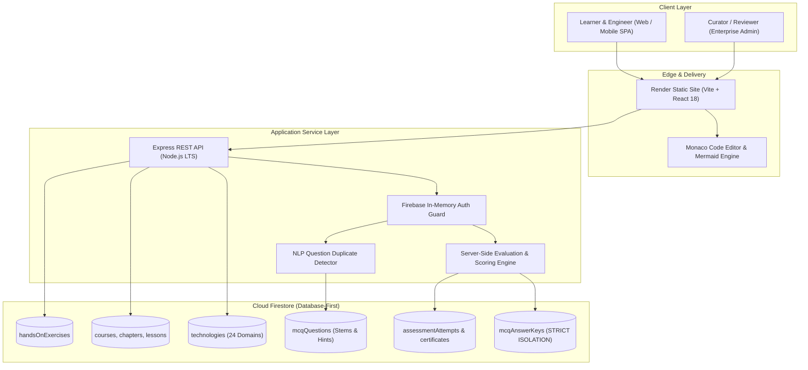

# ProjuktiX

> **Universal Open-Source Technology Learning and Professional Development Platform**  
> *A high-fidelity fusion of deep technical encyclopedia, interactive engineering academy, rigorous assessment system, and enterprise learning management.*

---

## 1. Project Overview

**ProjuktiX** is an enterprise-grade, open-source technology learning ecosystem designed to democratize high-depth technical mastery across the computing disciplines. Modeled after authoritative engineering compendiums such as the [Oracle DBA Encyclopedia](https://github.com/RatnadeepParya/Oracle-DBA-Encyclopedia), ProjuktiX replaces fragmented, high-level tutorials with exhaustive, database-driven technical encyclopedias, interactive hands-on laboratories, verified question banks, and authentic mock examinations.



---

## 2. Key Platform Capabilities

### 2.1 Universal Technical Encyclopedia
- **Database-Driven Content**: No documentation or tutorial content is hardcoded into application source files. All courses, chapters, and lessons are retrieved dynamically from Cloud Firestore.
- **Three-Panel Enterprise Reader**: Left-hand syllabus tree, centered long-form technical article with interactive code blocks and inline architecture diagrams, and right-hand table of contents with learning objectives.
- **Architectural Illustrations**: Native Mermaid.js rendering engine with pan, zoom, full-screen inspection, and export options.
- **Product & Version Awareness**: Content is tagged with specific release targets (e.g. Oracle 19c vs 23ai, Kubernetes 1.30, Python 3.12).

### 2.2 Rigorous Assessment Engine & Answer Key Isolation
- **Strict Answer Key Vault**: Correct answers are stored exclusively in the isolated `mcqAnswerKeys` collection, which is shielded by default-deny Firestore rules. Answer indices are never delivered to the client browser prior to evaluation.
- **Server-Side Evaluation**: Submissions to `/api/v1/assessments/submit` are evaluated server-side with linear negative marking penalties, duration tracking, and category-level diagnostics.
- **Cryptographic Credential Issuance**: Passing scores automatically generate verifiable completion certificates stored in `certificates` with public verification links (`/verify/:id`).

### 2.3 Interactive Hands-on Labs
- **In-Browser Terminal & Editor**: Integrated Monaco code editor with copy-ready command sequences, step-by-step instructions, and checkpoint validation.
- **Prerequisite Validation**: Clear architectural topology definitions and validation checkpoints for each laboratory exercise.

### 2.4 Enterprise Administrative Portal
- **Real-Time Telemetry**: Live metric cards displaying total technologies, published lessons, question bank volume, and active certificates.
- **Content Management**: Create, update, and manage technologies, syllabus structures, and learning tracks.
- **Bulk Ingestion with NLP Deduplication**: Import hundreds of questions via JSON with automated token similarity and shared n-gram analysis (>= 70% similarity flags) to prevent question bank contamination.

---

## 3. Curriculum Scope (24 Technical Domains)

ProjuktiX covers 24 core engineering domains encompassing modern computing:

| Domain | Description & Flagship Tracks |
|---|---|
| **Programming Languages** | C, C++, C#, Java, Python, TypeScript, Go, Rust, Kotlin, Swift, Dart, SQL, Assembly |
| **Frontend Engineering** | React, Next.js, Angular, Vue, Tailwind CSS, Web Components, Three.js, WebGPU |
| **Backend Frameworks** | Node.js, Spring Boot, FastAPI, Django, ASP.NET Core, Go Fiber, Microservices, gRPC |
| **Mobile Development** | Android Jetpack Compose, iOS SwiftUI, Flutter, React Native, Kotlin Multiplatform |
| **Desktop Engineering** | Electron, Tauri, Qt, WinUI, Cross-Platform Desktop Architecture |
| **Database Technologies** | Oracle (19c/23ai/RAC/Data Guard), PostgreSQL, MySQL, MongoDB, Redis, BigQuery |
| **Cloud Computing** | AWS, Google Cloud, Microsoft Azure, Multi-Cloud Architecture |
| **DevOps & SRE** | Kubernetes, Docker, Terraform, Ansible, Prometheus, CI/CD Pipelines |
| **Operating Systems** | Linux Kernel, Unix Systems Programming, Windows Internals, Embedded RTOS |
| **Computer Networks** | TCP/IP, BGP/OSPF Routing, Software Defined Networking, Network Security |
| **Cybersecurity** | Cryptography, Application Security, SOC Operations, Penetration Testing |
| **Data Engineering** | Apache Spark, Kafka, Apache Flink, Dataform, dbt, Modern Data Lakehouses |
| **AI & Machine Learning** | Deep Learning, PyTorch, Large Language Models, Generative AI, RAG Architectures |
| **Enterprise Systems** | SAP S/4HANA, Salesforce, Oracle E-Business Suite, Enterprise Integration |
| **Middleware & Messaging** | Kafka, RabbitMQ, IBM MQ, API Gateways, Service Mesh (Istio) |
| **HPC & Distributed Systems** | Distributed Consensus (Raft/Paxos), MPI, CUDA GPU Programming |
| **Software Architecture** | DDD, Event-Driven Architecture, CQRS, System Design Patterns |
| **QA & Test Automation** | Vitest, Playwright, Cypress, Performance & Chaos Testing |
| **Embedded & IoT** | ARM Cortex, ESP32, FreeRTOS, Embedded C++, IoT Protocols (MQTT) |
| **Computer Architecture** | CPU Microarchitecture, RISC-V, Cache Coherence, Memory Hierarchies |
| **Quantum Computing** | Qiskit, Quantum Algorithms, Quantum Information Theory |
| **Blockchain & Web3** | Ethereum, Solidity, Smart Contract Auditing, Cryptographic Proofs |
| **Spatial & Game Engine** | Unreal Engine, Unity, WebGL/WebGPU, Ray Tracing, Physics Engines |
| **Specialized Engineering** | Avionics, Financial Engineering, Healthcare Informatics, Bioinformatics |

---

## 4. Zero-Secret Architecture

ProjuktiX adheres strictly to a zero-persistent-secret model:

1. **No `.env` Files**: No `.env`, `.env.local`, `.env.production`, or other secret files exist in this repository.
2. **Dynamic In-Memory Credentials**: The backend reads `process.env` directly; the Firebase Admin SDK initializes in memory without requiring JSON files on disk.
3. **Public Client Config**: The frontend retrieves client configuration at runtime via `GET /api/v1/config`.
4. **CI Security Gate**: Automated workflows reject any commit introducing files matching `.env*`, `*credential*`, or `*.key`.

For comprehensive details, refer to:
- [Secrets Management Guide](docs/security/SECRETS_MANAGEMENT.md)
- [Firebase Dynamic Initialization](docs/security/FIREBASE_CREDENTIALS.md)

---

## 5. Quickstart & Local Development

### Prerequisites
- **Node.js**: LTS v20.x or higher
- **pnpm**: v11.15.x or higher

### Installation

```bash
# 1. Clone the repository
git clone https://github.com/RatnadeepParya/ProjuktiX.git
cd ProjuktiX

# 2. Install workspace dependencies
pnpm install

# 3. Build all workspace packages
pnpm run build

# 4. (Optional) Run tests
pnpm run test

# 5. Start development servers
pnpm dev
```

The application will be accessible at:
- **Frontend SPA**: `http://localhost:5173`
- **Backend API**: `http://localhost:4000`
- **API Health Check**: `http://localhost:4000/health`
- **Public App Config**: `http://localhost:4000/api/v1/config`

---

## 6. Monorepo Structure

```
ProjuktiX/
├── .github/
│   ├── workflows/
│   │   ├── ci.yml                 # Automated testing, typechecking, and secret audit
│   │   └── deploy.yml             # Render deployment dispatcher
│   └── ISSUE_TEMPLATE/            # Structured issue and content templates
├── apps/
│   ├── api/                       # Express LTS backend service
│   │   └── src/
│   │       ├── config/            # In-memory Firebase Admin & security config
│   │       ├── routes/            # REST API endpoints (/api/v1)
│   │       ├── services/          # Evaluation engine, duplicate detector, admin services
│   │       ├── scripts/           # Comprehensive database seed utility
│   │       └── __tests__/         # Vitest test suites
│   └── web/                       # React 18 + Vite SPA
│       └── src/
│           ├── components/        # Cyber UI, Mermaid viewer, Monaco editor
│           ├── context/           # Auth and theme state providers
│           ├── lib/               # Typed API client and dynamic Firebase SDK
│           ├── pages/             # Reader, Lab, Assessments, Dashboard, Admin
│           └── __tests__/         # Client-side unit tests
├── packages/
│   ├── types/                     # Shared TypeScript data models
│   ├── validation/                # Zod schemas for input validation
│   └── shared/                    # Scoring logic, NLP tokenizers, RBAC constants
├── docs/
│   ├── architecture/              # Detailed system architecture documentation
│   ├── deployment/                # Render Free Tier and CI/CD guides
│   └── security/                  # Zero-secret and credential policies
├── firebase/
│   ├── firestore.rules            # Default-deny, role-enforced security rules
│   └── firestore.indexes.json     # Production composite database indexes
├── pnpm-workspace.yaml            # Monorepo configuration
└── package.json                   # Root scripts and engine constraints
```

---

## 7. Deployment Runbook

ProjuktiX is architected to deploy directly to the **Render Free Tier**:
- **Backend API**: Render Web Service (Node.js runtime).
- **Frontend SPA**: Render Static Site (React/Vite bundle with SPA routing rewrites).

See [Render Deployment Documentation](docs/deployment/RENDER_SETUP.md) for full configuration parameters.

---

## 8. Community & Contributing

We welcome contributions from engineers, educators, and curriculum creators worldwide. Please read our [Contributing Guide](CONTRIBUTING.md) and review our [Community Standards](CODE_OF_CONDUCT.md).

For vulnerability disclosures, refer to our [Security Policy](SECURITY.md).

---

## 9. License

This project is licensed under the [MIT License](LICENSE).
Educational curriculum and documentation contributions are shared under open-access community principles.
