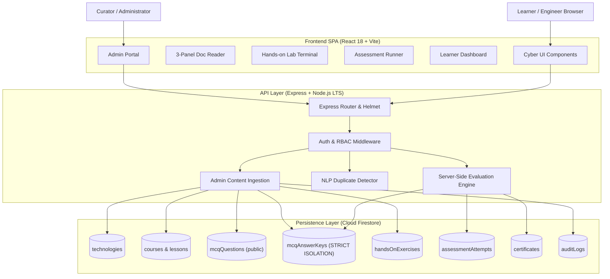

# ProjuktiX System Architecture

ProjuktiX is engineered as a database-driven, open-source technology learning ecosystem combining a universal technical encyclopedia, professional roadmaps, hands-on terminal exercises, verified question banks, and credential issuance.

---

## 1. High-Level Architecture



---

## 2. Core Architectural Pillars

### 2.1 Database-First Architecture
All educational content—technologies, courses, chapters, lessons, questions, answers, explanations, and exercises—is stored in Cloud Firestore. No educational content is hardcoded into frontend bundles or backend route files.

### 2.2 Strict Answer Key Isolation
To guarantee academic integrity:
1. `mcqQuestions` contains question stems, options, hints, and explanations, but **NEVER the correct answer indices**.
2. Correct answer keys are stored exclusively in the separate `mcqAnswerKeys` collection.
3. Firestore security rules deny all direct client read/write access to `mcqAnswerKeys`:
   ```cel
   match /mcqAnswerKeys/{keyId} {
     allow read, write: if false;
   }
   ```
4. Client browsers submit user selections to `/api/v1/assessments/submit`. The backend loads the answer key securely in memory, evaluates accuracy, computes penalties (negative marking), records the attempt, and issues a cryptographic certificate if passing thresholds are met.

### 2.3 Monorepo Organization
The monorepo uses `pnpm` workspaces:
- `packages/types`: Shared domain interfaces and TypeScript contracts.
- `packages/validation`: Zod schemas for input validation, content ingestion, and assessment submissions.
- `packages/shared`: Universal domain constants, RBAC definitions, tokenizers, scoring functions, and duplicate detection algorithms.
- `apps/api`: Express.js backend with Firebase Admin SDK, rate limiting, and RBAC guards.
- `apps/web`: React 18 single-page application with Tailwind CSS, Lucide icons, Monaco editor, and Mermaid diagram support.

### 2.4 Duplicate Question Detection
During bulk question ingestion via `/api/v1/admin/import`:
- Questions are normalized, tokenized, and stripped of punctuation.
- Jaccard similarity and shared n-gram analysis are performed against existing questions in the target technology.
- Questions with similarity >= 0.70 are flagged as near-duplicates in the import report, preventing question bank pollution.
